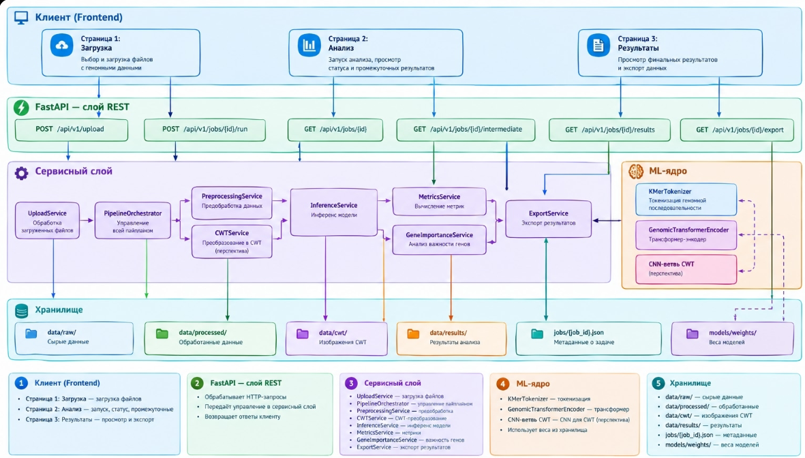

# Отчет за 12.10-18.10

Составили описание частичное описание структуры бэкенда приложения

## 1. Общая схема компонентов



Как это работает (упрощенно):
1. Пользователь загружает файлы -> POST /api/v1/upload -> UploadService -> data/raw
2. Запускает анализ -> POST /api/v1/jobs/{id}/run -> PipelineOrchestrator -> весь пайплайн
3. Пользователи предобрабатывают данные: предобработка -> CWT -> инференс -> метрики -> важность генов -> результаты
4. Результаты сохраняются в хранилище, а статус и промежуточные данные доступны через GET-запросы
5. Финальные результаты можно экспортировать через GET /api/v1/jobs/{id}/export -> ExportService -> data/results/
---

## 2. Загрузка данных — подробно

### 2.1. Что приходит с фронтенда

Со страницы «Загрузка» (`multipart/form-data`):

| Поле | Тип | Описание |
|------|-----|----------|
| `genotype` | file (.csv) | SNP-маркеры; эталонный формат — `total_df_for_aio_chickpea_28042016_synchro.csv` |
| `phenotype` | file (.csv) | уровни устойчивости к аскохитозу (классы 0–3) |
| `k` | int, default 6 | длина k-мера |
| `mask_prob` | float, default 0.15 | доля маскирования |
| `wavelet` | str, default `cmor` | материнский вейвлет для CWT |

### 2.2. Алгоритм `UploadService`

1. Сгенерировать `job_id` (UUID).
2. Создать каталоги `data/raw|processed|cwt|results/{job_id}/`.
3. Сохранить файлы как `genotype.csv`, `phenotype.csv`.
4. Прочитать CSV (pandas):
   - проверить наличие ID образцов;
   - посчитать число столбцов с префиксом `Ca`;
   - сверить пересечение ID между генотипом и фенотипом;
   - проверить, что фенотип ∈ {0, 1, 2, 3}.
5. Записать `jobs/{job_id}.json` со статусом `uploaded` и краткой статистикой.
6. Вернуть клиенту `job_id` и сводку (N образцов, M SNP после фильтра).

Ошибки валидации → HTTP 400 с понятным сообщением (нет столбцов `Ca`, пустой файл, несовпадение ID и т.д.).

### 2.3. Пример ответа upload

```json
{
  "job_id": "a3f1c2e0-...",
  "status": "uploaded",
  "summary": {
    "n_samples": 407,
    "n_snp_ca": 6642,
    "phenotype_counts": {"0": 90, "1": 113, "2": 140, "3": 64}
  }
}
```